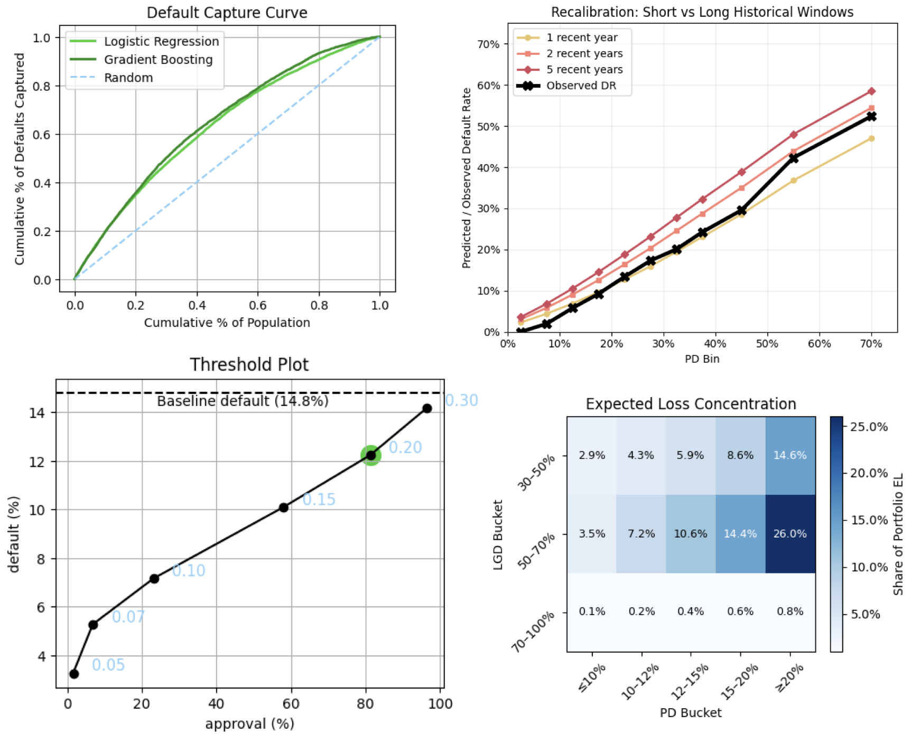

# Credit Risk Modelling Framework

A modular Python framework for developing, validating, and applying credit-risk models from Probability of Default (PD) through portfolio risk and credit decisioning. It started from a concrete application-time credit-risk modelling problem and evolved into a reusable framework for the broader credit-risk lifecycle.

## Overview

The framework covers:

⚫ PD model development and temporal validation 
⚫ PD calibration and recalibration 
⚫ LGD estimation and EAD integration 
⚫ Expected Loss (EL) analysis 
⚫ Monte Carlo portfolio loss simulation and Economic Capital 
⚫ Credit-policy and PD-threshold analysis 
⚫ Model diagnostics, explainability and fairness 
⚫ Input drift monitoring 
⚫ Automated testing and CI 

  

## Recommended Walkthrough

For a first look at the framework:

1. **[The First Case-Study](notebooks/00_first_case_study.ipynb)** — the initial business problem and the first modelling approach.
2. **[The PD Pipeline](notebooks/02_PD_pipeline.ipynb)** — the generalized PD modelling workflow.
3. **[Portfolio Risk Report](slides/reports/First_Report.pdf)** — portfolio overview, risk, and capital analysis.

## Future Extensions

Planned extensions include:

⚪ Stochastic LGD modelling 
⚪ Dedicated EAD modelling 
⚪ Inverse portfolio-risk analysis 
⚪ Configuration driven execution-retraining 
⚪ Model health dashboard 